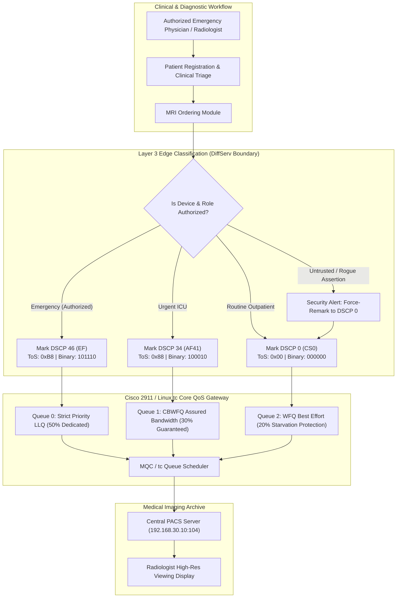
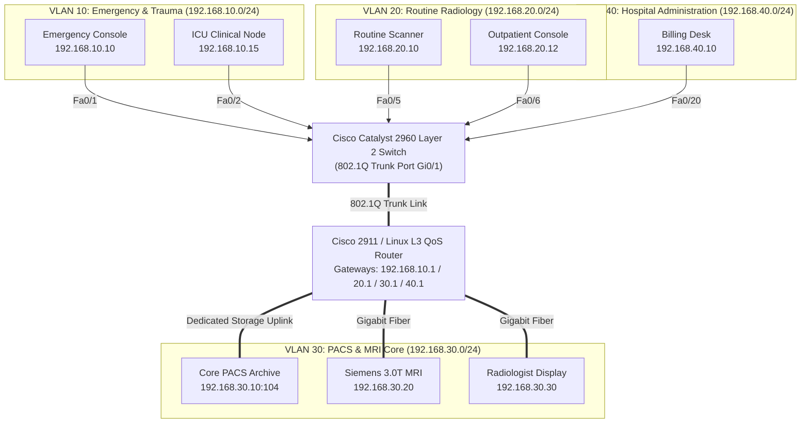
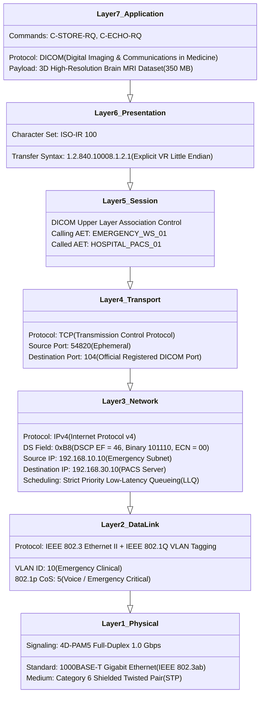
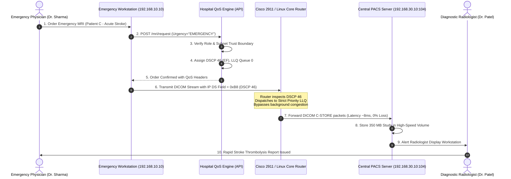
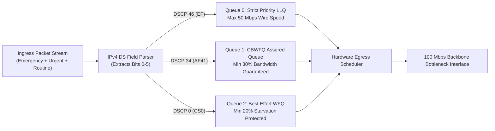

# System Architecture & UML Diagrams

## Project: Smart Hospital Emergency MRI Prioritization System
### Built on OSI Reference Model Layer 3 (Network Layer) & IP-Based DiffServ QoS

---

### Diagram 1: Overall System Architecture

---

### Diagram 2: Hospital VLAN Topology & Inter-VLAN Network Segmentation

---

### Diagram 3: OSI 7-Layer Reference Model Protocol Encapsulation

---

### Diagram 4: End-to-End Emergency DICOM Data Flow (Sequence Diagram)

---

### Diagram 5: Router Queuing & Starvation Prevention Model

